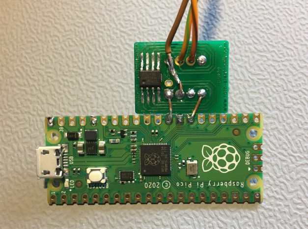
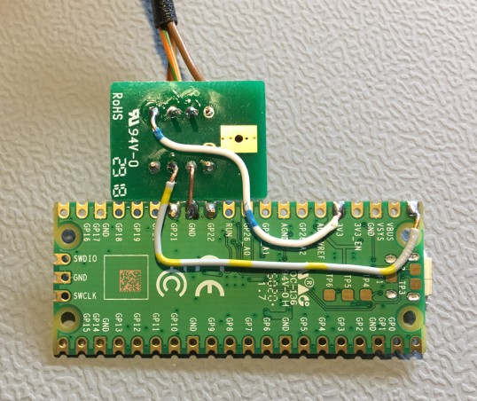

# Bit-bang-only CAN Pico (low-cost setup)

A minimal, low-cost setup to run the CANHack toolkit (Classical CAN **and** the
CAN FD extension) on a plain Raspberry Pi Pico. There is **no** SPI CAN
controller (no MCP2517FD / MCP2518FD): the RP2040 bit-bangs the CAN protocol in
software and only needs a CAN **transceiver** wired to two of its GPIO pins.

This is the hardware the CAN FD work in this repository was developed and tested
on. For the firmware and how to build it, see
[../BUILDING.md](../BUILDING.md); for the current feature status see
[../CANPico/firmware/CANFD_STATUS.md](../CANPico/firmware/CANFD_STATUS.md).

## Bill of materials

- a Raspberry Pi Pico (RP2040) — any plain Pico; no CANPico add-on board needed
- a **Microchip MCP2562FD** high-speed CAN FD transceiver (SOIC-8)
  <https://www.microchip.com/en-us/product/mcp2562fd>
- a **Roth Elektronik RE899** SOIC-8 → DIL (8-pad SMD DIL) adapter to make the
  tiny transceiver breadboard/solderable
  <https://www.roth-elektronik.com/pdf/en_RE899.pdf>
- two 120 Ω bus-termination resistors (one at each end of the CAN bus)
- a few wires

## Wiring

The firmware uses **GP21 as CAN RX** and **GP22 as CAN TX** (these are physical
pins 27 and 29; the GND on pin 28 sits conveniently between them). The transceiver
is a 5 V part with a separate I/O-level supply (VIO) that is tied to the Pico's
3.3 V so its logic levels match the RP2040.

| MCP2562FD pin | signal | Raspberry Pi Pico |
|---|---|---|
| 1 TXD  | transmit data (MCU → bus) | GP22 / CAN TX (pin 29) |
| 4 RXD  | receive data (bus → MCU)  | GP21 / CAN RX (pin 27) |
| 3 VDD  | 5 V supply                | VBUS (pin 40)          |
| 5 VIO  | I/O level reference       | 3V3 OUT (pin 36)       |
| 2 VSS  | ground                    | GND (e.g. pin 28)      |
| 8 STBY | standby (low = normal)    | GND                    |
| 7 CANH | CAN bus high              | CAN_H (120 Ω terminated) |
| 6 CANL | CAN bus low               | CAN_L (120 Ω terminated) |

This matches the wiring described in Fynn Denecke's thesis (`docs/` on the
`classic2` branch, figures 3.1–3.3), with the MCP2562FD in place of the
transceiver used there.

## The build

Front — the Pico next to the MCP2562FD soldered on the RE899 adapter, with the
TXD/RXD signal wires to GP21/GP22:

Back — the underside, showing the connections to the labelled Pico pins
(GP21/GP22, GND, 3V3, VBUS) and the CAN_H/CAN_L bus cable leaving the adapter:

## Notes

- Fixed bit rates: 500 kbit/s arbitration, 2 Mbit/s data (CAN FD). The 250 MHz
  overclock the FD firmware needs is handled in `main.c` (with a core-voltage
  boost for stability).
- Because the CAN protocol is bit-banged, a fully Classical-CAN-equivalent
  feature set is not reachable; the attainable function and its one physical
  limit (Janus in the 2 Mbit/s phase) are documented in `CANFD_STATUS.md`.
